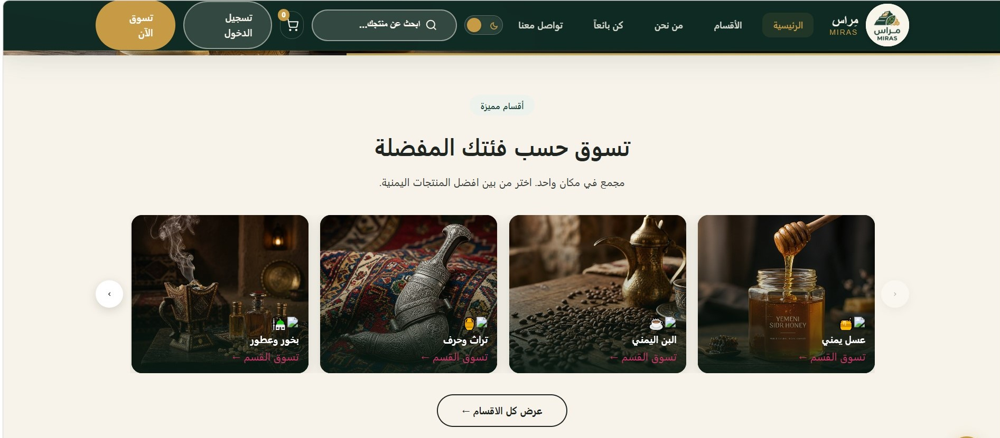
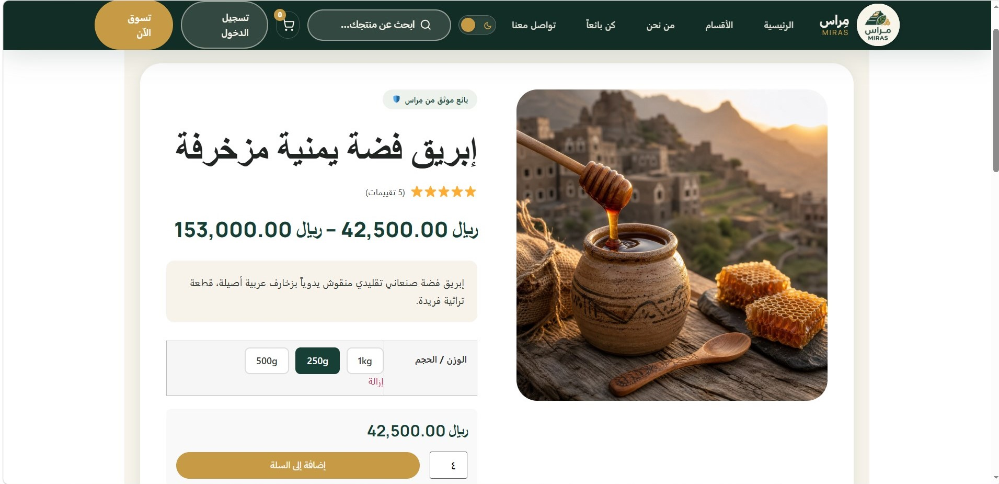



  <h1>🏺 MIRAS Store | متجر مِراس</h1>
  
Authentic Yemeni Marketplace | منصة التسوق للمنتجات اليمنية الأصيلة

  

    <a href="#english">🇬🇧 English</a> • <a href="#arabic">🇸🇦 العربية</a> • <a href="#screenshots">📸 Screenshots</a>
  

  
  
  
  
  

---

## 🇬🇧 English Documentation

### 📌 About the Project
**MIRAS** is an Arabic-first e-commerce platform built on **WordPress** and **WooCommerce**, designed as an online marketplace for authentic Yemeni products. It features a custom-built theme with full RTL support, a heritage-inspired design, and 60+ curated products across six main categories: Honey, Yemeni Coffee, Spices, Nuts, Heritage Crafts, and Gift Boxes.

### 🌟 Key Features
- **🎨 Custom Theme:** Built from scratch with full WooCommerce & RTL Arabic support.
- **🏪 6 Categories:** Curated catalog of authentic Yemeni goods (60+ items).
- **🛡️ Verified Seller Badges:** Trust badge system for certified local suppliers.
- **🔍 Instant Live Search:** Real-time AJAX product search.
- **📈 SEO Ready:** Rank Math SEO optimized for Arabic search engines.
- **📱 Fully Responsive:** Adaptive layout across mobile, tablet, and desktop devices.

### ⚙️ Tech Stack & Requirements
- **Core:** WordPress 6.7+ / WooCommerce
- **Runtime:** PHP 8.2+
- **Database:** MySQL 8.4+
- **Theme:** Custom MIRAS Theme (PHP, CSS3, JavaScript)

### 🚀 Setup & Installation
1. Clone the repository into your local server environment (e.g., LocalWP, XAMPP).
2. Import the database dump:
   ``
   app/sql/local.sql
   ``
3. Configure your database credentials in wp-config.php.
4. Activate the **MIRAS Theme** and required plugins from the WordPress admin panel.
5. Launch the site:
   ``
   Frontend:  http://miras.local
   Admin:     http://miras.local/wp-admin
   ``

 

---

## 🇸🇦 دليل الاستخدام (العربية)

### 📌 عن المشروع
**مِراس** منصة تجارة إلكترونية متخصصة في تسويق وبيع المنتجات اليمنية الأصيلة، مبنية على **WordPress** و**WooCommerce**. يتميز المشروع بثيم مخصص مبني من الصفر يدعم اللغة العربية واتجاه الـ RTL بشكل أصيل، ويضم أكثر من 60 منتجاً موثقاً موزعة على 6 فئات: العسل الدوعني والسدري، البن اليمني الفاخر، التوابل والبهارات، المكسرات، الحرف والمشغولات التراثية، وصناديق الهدايا الفاخرة.

### 🌟 أبرز المميزات
- **🎨 ثيم مخصص بالكامل:** مطوّر برمجياً ليتوافق تماماً مع WooCommerce ويدعم الـ RTL الأصيل.
- **🏪 6 فئات منتجات رئيسية:** كتالوج منظم يضم أكثر من 60 منتجاً يمنياً أصيلاً.
- **🛡️ شارة البائع الموثّق:** نظام شارات لتعزيز الموثوقية مع الموردين المعتمدين.
- **🔍 بحث فوري (AJAX):** تجربة بحث لحظية وسريعة عن المنتجات.
- **📈 مهيأ لمحركات البحث (SEO):** متكامل مع Rank Math لتحقيق أفضل ظهور في نتائج البحث باللغة العربية.
- **📱 متجاوب بالكامل:** تصميم انسيابي ومتناسق مع شاشات الهواتف والأجهزة اللوحية والمكتبية.

### ⚙️ التقنيات والمتطلبات
- **المنصة الأساسية:** WordPress 6.7+ / WooCommerce
- **بيئة التشغيل:** PHP 8.2+
- **قاعدة البيانات:** MySQL 8.4+
- **القالب:** ثيم مِراس المخصص (PHP, CSS3, JavaScript)

### 🚀 خطوات التشغيل
1. انسخ المستودع وضعه داخل بيئة العمل المحلية (مثل LocalWP أو XAMPP).
2. استورد ملف قاعدة البيانات:
   ``
   app/sql/local.sql
   ``
3. اضبط إعدادات الاتصال بقاعدة البيانات في ملف wp-config.php.
4. فعّل **قالب مِراس (MIRAS Theme)** والإضافات من لوحة تحكم ووردبريس.
5. تصفح الموقع:
   ``
   الواجهة الرئيسية:  http://miras.local
   لوحة التحكم:      http://miras.local/wp-admin
   ``

 

---

## 📸 Screenshots | لقطات من واجهة المشروع

  <h3>الصفحة الرئيسية | Home Page</h3>
  
    

  <h3>الأقسام والمنتجات | Categories</h3>
  
    

  <h3>تصفح الأقسام | Browse Categories</h3>
  
    

  <h3>صفحة المتجر والتسوق | Shop Page</h3>
  
    

  <h3>الأعلى مبيعاً | Best Sellers</h3>
  
    

  <h3>البحث المتقدم الفوري | Live AJAX Search</h3>
  
    

  <h3>صفحة انضم كبائع | Become a Seller</h3>
  
    

  <h3>نموذج طلب الانضمام كبائع | Seller Registration Form</h3>
  
    

  <h3>من نحن | About Us</h3>
  
    

  <h3>تواصل معنا | Contact Us</h3>
  

 

---

  
Built by <b>Eng. Waleed Mohsen Al-Ansi</b>

  
<b>برمجة وتطوير م. وليد محسن الآنسي</b>

  
📞 +967 773 157 823

  
🌐 <a href="https://waleed-al-ansi-cv.netlify.app">waleed-al-ansi-cv.netlify.app</a>

  
© 2026 MIRAS – Authentic Yemeni Marketplace. All Rights Reserved.

  
© ٢٠٢٦ مِراس – منصة المنتجات اليمنية الأصيلة. جميع الحقوق محفوظة.

